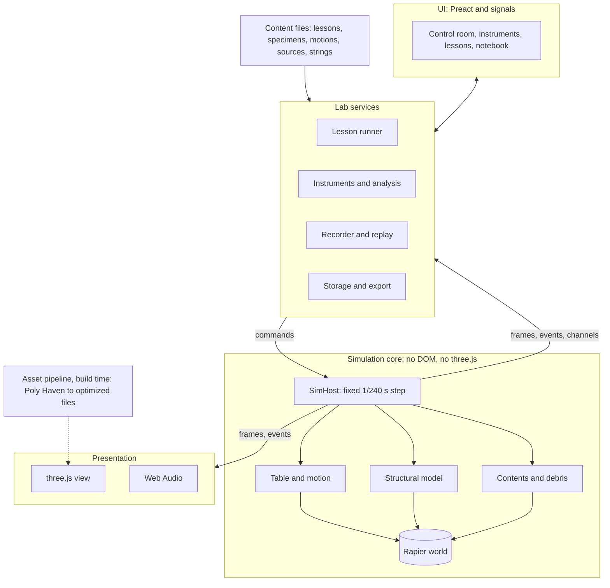
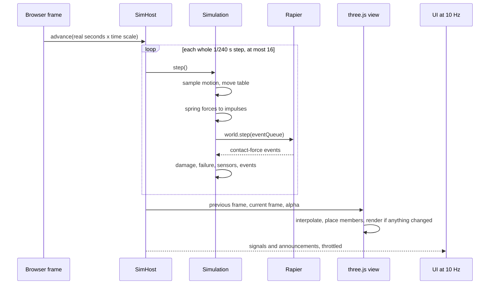
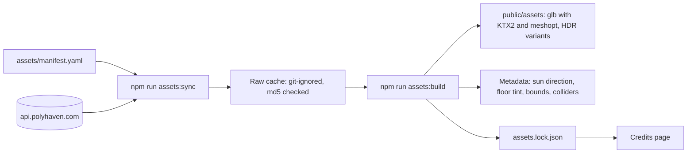
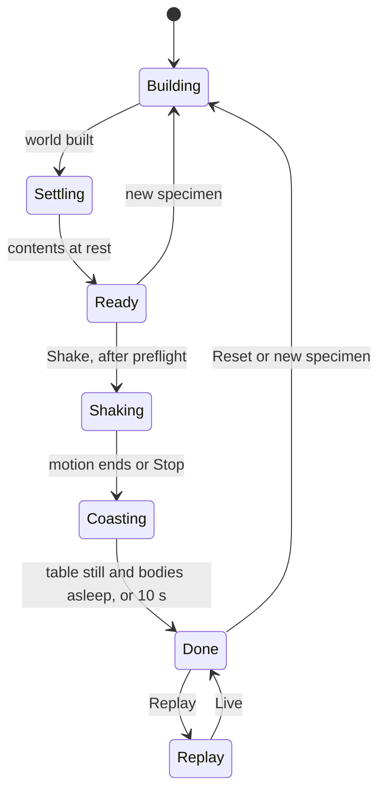

# Shake Table Lab architecture

**Status:** accepted. Phase 0 is in progress (section 16).

**Date:** 2026-10-13

**Scope:** how to turn the single-file proof of concept into a full-scale lab, still built on three.js, Poly Haven and Rapier.

The proof of concept is one `index.html` (1,219 lines) plus `HANDOFF.md` (last updated 2026-10-12). Neither is in this repository yet. Phase 0 adds them under `prototype/` (section 16).

## Contents

1. [Summary](#1-summary)
2. [What "full-scale lab" means](#2-what-full-scale-lab-means)
3. [Starting point: the prototype](#3-starting-point-the-prototype)
4. [System overview](#4-system-overview)
5. [Simulation core (Rapier)](#5-simulation-core-rapier)
6. [Rendering (three.js)](#6-rendering-threejs)
7. [Assets (Poly Haven)](#7-assets-poly-haven)
8. [The lab experience](#8-the-lab-experience)
9. [UI](#9-ui)
10. [Audio](#10-audio)
11. [Storage, privacy and Canvas](#11-storage-privacy-and-canvas)
12. [Accessibility](#12-accessibility)
13. [Performance](#13-performance)
14. [Testing and verification](#14-testing-and-verification)
15. [Build, deployment and versioning](#15-build-deployment-and-versioning)
16. [Delivery plan](#16-delivery-plan)
17. [Risks](#17-risks)
18. [Decisions](#18-decisions)
19. [Open questions](#19-open-questions)
- [Appendix A. Prototype to module map](#appendix-a-prototype-to-module-map)
- [Appendix B. Data shapes](#appendix-b-data-shapes)
- [Appendix C. Facts checked for this document](#appendix-c-facts-checked-for-this-document)

## 1. Summary

The prototype proves the core idea. A Rapier world with three 4,000 kg floor slabs on custom springs, driven by a kinematic shake table, teaches resonance, bracing and base isolation, and it looks real because of the Poly Haven halls and props. This plan keeps that core and rebuilds everything around it, so students can use the lab for a whole unit instead of a demo.

| Area | Prototype | Full-scale lab |
|---|---|---|
| Code | One HTML file with shared globals | TypeScript modules and a Vite build. The simulation core has no DOM or three.js imports |
| Libraries | three.js 0.181.2 and Rapier 0.19.3, loaded from jsDelivr at runtime | Same libraries installed from npm, pinned and bundled. Upgraded one at a time behind tests |
| Physics | 3 stories. Story springs applied as impulses at 240 Hz. Damage by drift | Same method, because it works. Generalized to more stories, springs at plan positions, hysteresis, P-Delta, dampers, seeded randomness and a deterministic engine build |
| Shaking | Steady, sweep and a synthetic quake, on one axis | Adds recorded earthquakes with sources, pulses, uploaded motions, a second horizontal axis and a table performance check |
| Assets | Fetched live from api.polyhaven.com. About 38 MB on first load | Downloaded at build time, compressed and self-hosted. First load of at most 10 MB on Chromebooks and 20 MB elsewhere |
| Data | Four readouts and a 12 s chart | Virtual sensors sampled at 240 Hz, analysis tools, CSV export and run comparison |
| Learning | Six guided tests | Lessons as content files, a notebook, lab report export, a design challenge and a Canvas activity |
| Quality | Checked by hand in headless Chrome | Unit tests, physics scenario tests, browser tests, accessibility checks and CI |

Twelve decisions shape the design (section 18). The four that matter most:

1. **Rapier stays the only integrator.** Building springs stay custom impulses, the method the prototype verified.
2. **The simulation core is separate from rendering and the DOM.** It runs in Node for tests and can move to a worker later.
3. **Poly Haven is used at build time only.** The lab serves its own optimized copies.
4. **Physics is identical on every device.** Quality tiers change what students see, never the numbers they measure.

Delivery runs in five phases (section 16). Phases 0 and 1 change nothing a student would notice. They prove that the modular port reproduces the prototype's verified results. New lab features start in phase 3.

## 2. What "full-scale lab" means

1. **Full-size specimens in real units.** The prototype's building is already close to full size: one 3 m by 3 m bay, 2 m stories and 0.2 m concrete slabs of 4,000 kg. The lab keeps SI units and real scale everywhere, so every number a student reads is a real-world number. The facility grows to match, with a crane, a control room, barriers and instrument cables.
2. **A full lab workflow.** Students plan a specimen, instrument it, predict, test, analyze the data and report. The lab does more than "press Shake and watch".
3. **Production quality.** This covers everything in the handoff's "If it goes to production" list: vendored libraries, local assets, modules, an accessibility pass, a Chromebook mode, a course objective and a Canvas activity.

### Goals

- **G1.** Every test in the six-stop tour gives the same outcome as in the prototype.
- **G2.** Students can build and test their own specimen within safe limits.
- **G3.** Every number on screen comes from a defined sensor with units and can be exported.
- **G4.** The lab runs at 30 fps or better on the baseline Chromebook (to be named, section 19) and at 60 fps on a typical laptop.
- **G5.** The lab meets WCAG 2.2 AA and keeps a full text version.
- **G6.** The lab is a static site with no accounts, no tracking and no runtime calls to other servers.
- **G7.** Instructors can point a Canvas assignment at a lesson and collect a report.

### Non-goals

- It is not a design tool. The prototype's About page says so, and that stays true. The model is simplified for teaching.
- There is no finite-element analysis. Members are springs and floors are rigid bodies.
- v1 has no server, logins or grade passback. Section 11 lays out the options.
- v1 has no VR and no multiplayer.

### Constraints

- The lab runs on Chromebooks on school Wi-Fi, often 30 at once.
- The lab runs inside a Canvas page (iframe) as well as on its own.
- On-screen text has no em dashes, no semicolons and no middle dots. Real-world claims are tagged and sourced.
- The repository is public.

## 3. Starting point: the prototype

### 3.1 What carries over

The handoff's checks prove these ideas, and they carry over unchanged:

- **Shear-building model.** One rigid slab per floor. Each story has a custom spring and damper, applied as Rapier impulses every 1/240 s step, with horizontal, vertical and rotational stiffness (`applySprings`).
- **Damage and failure.** Damage builds past a yield drift. Past an ultimate drift, the story fails into real Rapier pieces and the floors above fall (`failStory`).
- **Moving parts.** The table is a kinematic body. The wall and the furniture are free dynamic bodies.
- **Seeded quake.** The synthetic quake is seeded (`makeQuake`), so it is the same every time.
- **Replay.** The last 15 seconds replay with interpolation, scrubbing and replayed events.
- **Sound.** Procedural Web Audio with no sound files.
- **Content features.** Real world and Model tags, the text version, deep links (`#stop=N&run`) and the `window.__lab` test hook.

### 3.2 What has to change

| Prototype | Problem | Fix |
|---|---|---|
| One file with shared globals | Hard to test or change one part safely | Modules with one-way dependencies (section 4) |
| Libraries from jsDelivr and assets from api.polyhaven.com at runtime | The lab breaks if either is down. Poly Haven's API terms give no uptime guarantee | npm packages bundled at build time, and self-hosted assets (section 7) |
| About 38 MB on first load: a 6.9 MB HDRI, 7.5 MB of textures and 23.3 MB of props | Slow on school Wi-Fi. A class of 30 pulls about 1.1 GB at once | Compressed textures and meshes, with size budgets enforced in CI |
| Impacts are detected from each body's change in velocity per rendered frame (`detectImpacts`) | The result depends on frame rate. A 30 fps Chromebook sees bigger jumps than a 60 fps laptop, so sound and dust differ by device, and slow motion hides impacts | Rapier contact-force events, read every physics step |
| `Math.random()` sets debris kicks and sizes | Two runs of the same test differ | Seeded random streams |
| No interpolation between physics steps | Slow motion at 0.2x steps the world 48 times a second, below the display rate, so motion judders | Interpolated poses at render time |
| Replay records `dyn.children` by index, allocates a new array each frame and trims with `Array.shift` | Replay is tied to scene-graph order and churns memory | A preallocated ring buffer of poses keyed by stable body id |
| The sun direction and floor tint come from scanning HDRI pixels on the CPU | Needs full-float textures, about 34 MB of GPU memory for one 2k HDRI, and slows loading | Computed once at build time and stored with the asset |
| Credits are written by hand | Already wrong. About lists `painted_concrete`, which is never loaded, and leaves out `concrete_floor_worn_001`, which is | Credits generated from the asset lock file |
| `setTimeout(startShake, 700)` starts guided tests | Races the world rebuild on slow devices | The lesson runner waits for a Ready state |
| Modals have no focus trap | Keyboard users can tab behind a dialog | Native `<dialog>` with `showModal()` |
| 220 dust sprites, each with its own material | Up to 220 draw calls during a collapse | One instanced draw call |
| Renders every frame, even when nothing moves | Drains laptop and Chromebook batteries | Render on demand when idle |
| Fonts come from Google Fonts | A third-party request on every load | Self-hosted fonts. Barlow and JetBrains Mono both use the SIL Open Font License |

One handoff check is still open. The block wall was changed to 0.18 m blocks that sleep at rest, after a 0.14 m wall fell over by itself, and the re-test was cut off. Phase 0 confirms whether the wall stands at rest (section 16).

### 3.3 Results to preserve

The handoff verified these in headless Chrome on 2026-10-12:

- The sweep collapses the bare frame at about 1.14 Hz.
- The braced frame survives the sweep with cracking.
- Steady shaking at 3 Hz does nothing to the bare frame.
- The quake collapses the bare frame 6.5 s in.
- The isolated building rides out the quake.
- Replay works, and the lab runs at 60 fps while shaking.

These modal frequencies come from the prototype's constants, for the undamaged linear model. The new modal analysis must reproduce them:

| Building | Mode 1 | Mode 2 | Mode 3 | Mode 4 |
|---|---|---|---|---|
| Bare frame | 1.196 Hz | 3.350 Hz | 4.842 Hz | |
| Braced | 2.929 Hz | 8.207 Hz | 11.859 Hz | |
| Isolated | 0.397 Hz | 5.064 Hz | 9.316 Hz | 12.163 Hz |

Mode 1 matches the handoff's 1.2, 2.9 and 0.4 Hz. The sweep collapse at 1.14 Hz, just below 1.196 Hz, fits a frame that damage has already softened.

## 4. System overview

### 4.1 Layers



Four rules keep the layers apart. A lint rule enforces the import restrictions:

- `core/sim`, `shake-table/specimen` and `shake-table/motion` import nothing from three.js or the DOM. They run in a browser, a worker or Node.
- Rendering reads simulation frames and never writes to the physics world.
- The UI changes the simulation only through commands, which take effect at step boundaries.
- `core/**` never imports from `shake-table/**`. If gravity-lab grows more labs, `core` becomes the shared engine.

### 4.2 One frame



Simulated time is the only clock for data. If a slow device cannot keep up, the lab runs slower than real time and says so ("Running at 0.6x speed"). Every sensor sample still lands at the right simulated time. The lab never skips physics to catch up.

### 4.3 Repository layout

```text
gravity-lab/
├── index.html                 Vite entry
├── src/
│   ├── main.ts                boot: settings, assets, simulation, view, UI
│   ├── core/                  lab-agnostic engine
│   │   ├── sim/               SimHost, fixed-step clock, Rapier adapter, seeded RNG, events, recorder
│   │   ├── render/            renderer, quality tiers, view registry, camera rig, effects
│   │   ├── assets/            manifest loader, KTX2, meshopt and HDR loaders, fallbacks
│   │   ├── instruments/       channels, ring buffers, FFT and spectra, CSV
│   │   ├── lessons/           lesson runner, step types, answer checks
│   │   ├── audio/             Web Audio voices
│   │   ├── storage/           IndexedDB, import and export, migrations
│   │   └── ui/                shell, dialogs, panels, charts, announcements
│   └── shake-table/           this lab
│       ├── specimen/          spec, compiler, element laws, modal analysis, failure
│       ├── motion/            motion sources, table envelope, preflight
│       ├── contents/          props, block wall, shelves, lamps
│       ├── scene/             hall, pit, actuators, specimen views, stress colors, cameras
│       └── ui/                control room, instruments, specimen builder
├── content/
│   ├── lessons/               one YAML file per lesson
│   ├── specimens/             presets
│   ├── motions/               processed records with provenance
│   ├── halls/                 per-hall placements, lights, camera presets
│   ├── props.yaml             mass, friction, collider recipe, hazard tags
│   ├── table.yaml             table performance envelope
│   ├── sources.yaml           citations for Real world claims
│   └── strings/en.yaml        UI text
├── assets/
│   ├── manifest.yaml          the Poly Haven assets the lab uses
│   └── assets.lock.json       generated: hashes, sizes, authors, license
├── public/assets/             generated, optimized files (committed)
├── scripts/                   assets-sync, assets-build, motions-build, lint-content, instructor-key
├── tests/                     unit/, scenarios/, e2e/
├── prototype/                 the proof of concept, frozen for comparison
└── docs/                      this document and later decision records
```

## 5. Simulation core (Rapier)

### 5.1 Conventions

- **Units.** SI throughout: m, kg, s and N. The display converts to cm, g and kN.
- **Axes.** y is up. x is the table's main shaking axis, with the actuators on the reaction wall at -x as now. z is the second horizontal axis.
- **Step.** A fixed step of 1/240 s, with at most 16 steps per rendered frame, as now.
- **Drift ratio.** Relative floor displacement divided by the clear column height of 1.8 m, as in the prototype. Engineers usually divide by the floor-to-floor height instead, so the lessons define drift once, in plain words.

### 5.2 Engine package and version

**Package.** Use `@dimforge/rapier3d-deterministic-compat`. It is the cross-platform deterministic build with the WebAssembly inlined, so it needs no bundler setup. On 0.19.3 it costs 0.01 MB more than the build the prototype uses (0.84 MB against 0.83 MB gzipped).

**Upgrade path.** Pin exact versions and upgrade in three separate steps. The scenario suite gates each step:

1. Port on `rapier3d-compat` 0.19.3, the prototype's exact build.
2. Switch to `rapier3d-deterministic-compat` 0.19.3.
3. Upgrade to the current release, 0.21.0 at the time of writing.

**What the upgrade changes.** Rapier's changelog for engine versions 0.35 and 0.36 (released as JS 0.20 and 0.21) lists:

- **Sleeping was rewritten.** Islands now sleep as a unit, with new thresholds. The block wall's at-rest check must be repeated.
- **Contact defaults changed** to reduce tunneling. The prediction distance went from 0.002 to 0.02, the maximum corrective velocity from 10 to 3, and the allowed error from 0.001 to 0.005. Impact thresholds need recalibrating.
- **Also new.** A NaN quarantine freezes a broken body instead of corrupting the world. Velocities are capped each substep. Enhanced determinism has no measurable cost. Allocation-free getters such as `translation(target)` cut garbage collection in the 240 Hz loop.
- **Old snapshots no longer load.** The lab never stores Rapier snapshots, only its own data.
- **Files moved under `dist/`.** CDN paths like `rapier3d-compat@0.19.3/rapier.mjs` break. Bundling from npm avoids the problem.
- **Size.** The compat build grows from 0.84 MB gzipped (0.19.3) to 1.09 MB (0.20.0) and 1.65 MB (0.21.0). 0.21.0 adds soft bodies, which the lab does not use yet.

JS 0.20.0 predates the engine's 0.35.2 fix to contact-force reporting, and the 0.20 line got no JS patch releases. The target is therefore the current 0.21.x line. If download size matters on Chromebooks, the non-compat package ships the WebAssembly as a separate 1.17 MB (gzipped) file that the browser compiles while it streams. That option needs a Vite WebAssembly plugin.

**Settings.** World settings stay as in the prototype: gravity of -9.81, a timestep of 1/240 s and 8 solver iterations. They are retuned only together with the scenario suite.

**Adapter.** A thin adapter (`core/sim/physics.ts`) wraps every Rapier call the lab makes, so engine API changes stay in one file.

### 5.3 Structural model

The building is a stack of rigid floor slabs, each a Rapier dynamic body, joined by springs that the lab computes itself.

**Why custom impulses and not Rapier joints.** Rapier's JS bindings offer motors on prismatic and revolute joints and, since 0.20, per-axis angular motors on spherical joints. They offer no motors on six-degree-of-freedom generic joints. `JointData.spring` is a distance spring, not a shear spring. The prototype computes the force and applies `F * dt` as an impulse before `world.step()`. That method works and is verified, so it stays.

**Why not a separate structural solver.** A dedicated implicit solver with kinematic floors looks more like engineering software. But it needs a second integrator and one-way coupling to the furniture. It also needs a hand-off at collapse, where the floors above a failed story still need springs inside Rapier. That doubles the hardest code. A linear model built from the same specification (5.4) provides the engineering checks instead.

`specimen/compile.ts` builds the model from a specimen specification (Appendix B):

- **Floors.** One cuboid rigid body per floor, plus a base slab for an isolated building. Mass and size come from the specification.
- **Lateral springs.**
  - Model 1 is the prototype: one spring per story at the slab center, with force `F = -k * (1 - 0.3 * damage) * d - c * v` and damping `c = 2 * ζ * sqrt(k * m)`.
  - Model 2 (phase 4) uses one spring per element (column, brace or wall panel) at its plan position. A symmetric building has the same total stiffness, so its modal results do not change. Off-center stiffness now produces torsion, for example when only one side is braced.
- **Support springs.** Vertical and rocking stiffness are not teaching points. They would be too stiff to integrate explicitly if made realistic, so they stay as numerical support springs. The prototype derives them from target frequencies (10 Hz and 8 Hz) instead of member properties. Its vertical spring scales with the number of stories, so it stiffens as stories are added. Model 2 sets support springs per story so that they stay constant as the building grows.
- **Element laws.** An `ElementLaw` turns drift and velocity into force and damage.
  - `prototype-damage` (Model 1) is elastic. Stiffness drops by up to 30% as damage builds while drift exceeds the yield drift, and the element fails at the ultimate drift. It stays for parity.
  - `bilinear` (Model 2) has yield, post-yield hardening, unloading with stiffness degradation, a cyclic damage index and fracture at the ultimate drift. It leaves residual drift, so a building can survive but lean. That outcome is a lesson in its own right.
- **P-Delta.** Model 2 adds a destabilizing force equal to the weight above a story times its drift, divided by its height. Past a point the story's stiffness turns negative and the building leans over on its own. That is how real sidesway collapse happens, and it leaves less of the outcome to the fracture rule.
- **Dampers and isolators.**
  - Viscous dampers with `F = c * v^α`.
  - Rubber and lead-rubber isolators, starting from the prototype's linear isolator and its 0.45 m moat.
  - Friction pendulum isolators (phase 4).
  - A tuned mass damper: an extra roof body on its own spring and damper.
- **Stability guard.** The prototype integrates its springs explicitly, so the springs are stable only while each vibration mode stays under the integrator's limit. For semi-implicit Euler with explicit damping, that limit is `h² + 4ζh < 4`, with `h = ω dt`. The compiler computes every mode of the assembled springs (lateral, vertical and rotational) and rejects a specimen above 70% of the limit. The student sees a plain message. Today's worst case is the isolated building's highest vertical mode, at 32.6 Hz, which uses 66% of the limit. The prototype's support springs grow with the number of stories, so the same formula at 6 stories reaches 111% and blows up. That is why Model 2 fixes support springs per story, and why the guard has to exist before the specimen builder does.

**Failure.** As in the prototype, a failed story stops carrying force. Its members are hidden and replaced by Rapier pieces, and concrete chunks spawn, all drawn from seeded random streams. The floors above keep their springs to each other, so an upper block falls as a unit, as now. Pieces sleep once they settle. Debris counts are fixed for each event and never scaled by device.

### 5.4 Linear model and modal analysis

`specimen/modal.ts` assembles mass and stiffness matrices from the same specification and solves the eigenproblem. Model 1 is lateral only, and Model 2 adds torsion. The solver is Jacobi, as in the prototype's `eigSym`, which is fine up to about 30 degrees of freedom. The results drive:

- the "Natural beat (model)" readout
- predictions in lessons
- lesson answer checks (`near: model.mode1`)
- the test oracle: a free-vibration run in Rapier must ring at mode 1 within 2%

### 5.5 Shake table and motions

- **Table.** The table stays a kinematic body. A `MotionSource` supplies displacement, velocity and acceleration for each axis at time t. These are analytic where possible, so the reported table acceleration is exact instead of a second difference.
- **Motion types.** Steady sine with ramps. Sweep, linear or logarithmic. Synthetic quake: the prototype's generator with its seed for parity, and a filtered-noise generator later. Recorded earthquakes, pulses and uploaded CSV files.
- **Performance envelope.** The table's limits live in `content/table.yaml`: a stroke of ±0.5 m as now, plus velocity and acceleration limits. Before shaking, a preflight check compares the motion with the envelope and says what will happen, for example "This table can reach 0.50 g at 0.5 Hz. The run will use 0.50 g instead of 0.60 g". The prototype clips to the stroke silently.
- **Recorded earthquakes.** `scripts/motions-build.ts` processes them offline: baseline correction, filtering, integration to displacement, scaling and a stroke check. Each file keeps its provenance (event, station, component, source and license) and goes through the same source review as other Real world claims.
- **More axes.** Phase 4 adds the second horizontal axis, and optionally the vertical one, from 2- or 3-component records.

### 5.6 Contents and nonstructural parts

- **Props catalog.** `content/props.yaml` holds each prop's mass, friction, restitution and collider recipe. A recipe is a box, compound boxes or a convex hull, computed at build time from the mesh. The prototype's 97% bounding box remains the fallback.
- **Block wall.** The wall keeps the 0.18 m blocks that sleep at rest. It must pass the at-rest check on every engine version.
- **New contents.** Steel shelving with boxes, a bookcase, a filing cabinet, hanging lamps on rope joints (real pendulums), and a classroom floor with desks and chairs.
- **Hazard tags.** Each prop can carry a hazard tag (topples, slides or falls from height). The "What falls first" lesson and challenge scoring use them.

### 5.7 Events

Events are typed and carry simulated time and position: `crack`, `yield`, `fail`, `impact`, `topple`, `slide` and `table-limit`. Impacts come from Rapier contact-force events (`ActiveEvents.CONTACT_FORCE_EVENTS` with a threshold per collider), read every step. Events feed the audio, dust, the notebook log, replay and the lesson runner.

### 5.8 Reproducibility

- The simulation uses no `Math.random()` and no wall-clock time. Named seeded streams cover debris, wall texture offsets and the synthetic quake.
- Every run stores the app version, model version, engine versions, seed, specimen and motion, so it can be run again.
- With the deterministic build, results are the same on any Chrome device. Bit-exact results across different browsers are not promised, because JavaScript's `Math.sin`, `Math.exp` and similar functions may differ between browser engines. Tests use tolerances, not exact values.

### 5.9 Threads

In v1 the simulation runs on the main thread behind a `SimHost` interface that passes only plain data: commands go in, and frames and events come out. If the baseline Chromebook spends more than 8 ms per frame on physics at the 90th percentile, the host moves into a Web Worker and sends frames as transferable buffers. The design avoids `SharedArrayBuffer`. It needs cross-origin isolation headers, which GitHub Pages cannot send, and an embedded page cannot be cross-origin isolated unless the page around it (Canvas) is too.

## 6. Rendering (three.js)

### 6.1 Renderer

The lab uses `WebGLRenderer` (WebGL2), as now. three.js's `WebGPURenderer` is mature enough to consider. But the port should change one thing at a time, and WebGL2 is the safest choice across Chromebook GPUs. Re-evaluate after phase 3 with a measured trial on the baseline Chromebook.

Upgrade notes for 0.181 to 0.186:

- `PCFSoftShadowMap` was removed in r186. three.js falls back to `PCFShadowMap` with a warning.
- `Clock` is deprecated in favor of `Timer` (r183).
- `Source` was renamed `TextureSource` (r186).

Every add-on the lab needs still exists: `HDRLoader`, `GroundedSkybox`, `GLTFLoader`, `KTX2Loader`, `UltraHDRLoader`, the meshopt decoder, `GTAOPass`, `SMAAPass` and `OutputPass`.

### 6.2 Scene

- **Hall.** HDRI environment and `GroundedSkybox` as now, a floor patch tinted to match, the pit, the reaction wall and the actuators. Then the full-scale dressing: overhead crane, barriers, wall-mounted cameras, cable runs and a control room desk with monitors.
- **Specimen.** Slabs are meshes. Members (columns, braces and bearings) are instanced meshes placed between the two floor poses each frame, as in the prototype's `updateMembers`.
- **Contents and debris.** Props are cloned glTF scenes. Repeated props and debris are instanced meshes.
- **Effects.** Dust is one instanced draw call. Damaged members get crack decals. A beacon light shows while the table is live.
- **Overlays.** Stress colors, sensor markers, and labels drawn with `CSS2DRenderer` as real DOM text.

### 6.3 Binding the simulation to the view

A view registry maps each stable body id to an object or an instance slot. Each frame, the view interpolates between the last two simulation frames and updates the transforms. Bodies added at runtime, such as debris, get views from pools. Replay feeds the same registry from recorded frames, so live and replay share one code path.

### 6.4 Materials, color and light

- **Materials.** Poly Haven PBR materials, as now: color, normal and ARM maps (ambient occlusion, roughness and metalness packed together). They load as KTX2 instead of JPEG.
- **Tone mapping.** ACES Filmic stays for parity. Neutral is worth a later trial.
- **Light.** The shadow-casting light sits where the HDRI's brightest light is, as now. Its direction is metadata computed at build time.
- **Stress colors.** A color-blind-safe ramp with enough contrast against the hall. Story pills always show numbers and words (OK, Cracking, Failed), so color is never the only signal.

### 6.5 Cameras

- **Orbit**, with mouse, touch and keyboard.
- **High speed**, a fixed side view.
- **Ride along**, attached to a floor, with a stabilized option and a motion warning.
- **Crane and sensor views**, in phase 4.

On the High tier, control room monitors show live camera feeds through render targets.

### 6.6 Quality tiers

| Setting | Low (Chromebook) | Medium | High |
|---|---|---|---|
| Pixel ratio | 1 | up to 1.5 | up to 2 |
| Shadow map | off | 1024 | 2048 |
| HDRI | 1k | 2k | 2k |
| Textures | 512 | 1k | 1k |
| Anti-aliasing | FXAA | MSAA | SMAA |
| Ambient occlusion | off | off | GTAO |
| Dust particles | 60 | 150 | 220 |
| Control room monitors | off | off | on |
| Physics | identical | identical | identical |

The lab first picks a tier from device hints: `navigator.deviceMemory`, core count and maximum texture size. It then watches frame time for the first seconds and steps down if needed. The choice is saved and can be changed in Settings. When nothing moves and the camera is still, the lab stops rendering.

### 6.7 Failure handling

- **No WebGL.** The lab shows the text version and a plain message.
- **Lost GPU context**, which is common on low-memory devices. The lab pauses, waits for the context to come back, then rebuilds GPU resources.
- **Missing asset.** The lab falls back to `RoomEnvironment` and plain colored boxes, as the prototype does.

## 7. Assets (Poly Haven)

### 7.1 Policy

- **Build time only.** Only build scripts call the Poly Haven API, never students' browsers. The lab serves its own copies.
- **Identify the client.** Poly Haven's API terms require every request to carry a unique Referer or User-Agent. The sync script sends `User-Agent: gravity-lab-asset-sync (+https://github.com/wangy113/gravity-lab)`.
- **Credits.** The assets are CC0. The terms ask for a "Powered by Poly Haven" style credit only when the live API surfaces content, which the lab will stop doing. The credits page stays anyway, generated from the lock file.
- **Offline builds.** The API has no uptime guarantee, so builds work offline from committed outputs.

### 7.2 Pipeline



- **Manifest.** `assets/manifest.yaml` lists each asset: Poly Haven id, type, role, which tiers need it and the target resolution.
- **Sync.** `npm run assets:sync` calls `/info/{id}` and `/files/{id}`, downloads the listed files into a git-ignored cache and checks each one against the md5 the API reports. `/info` also returns a `files_hash`, so the script can tell when Poly Haven has changed an asset.
- **Build.** `npm run assets:build` processes everything:
  - **Props.** Dedupe, weld, resize textures, compress textures to KTX2 (ETC1S for color, UASTC for normals) and meshes with meshopt. One `.glb` per prop, built with gltf-transform and KTX-Software.
  - **Textures.** KTX2 at 512 and 1k.
  - **HDRIs.** 1k and 2k `.hdr`, plus an UltraHDR (JPEG with a gain map) candidate. The UltraHDR file is adopted only if its lighting matches the `.hdr`, because UltraHDR can clip the brightest lamps.
  - **Metadata.** Sun direction and floor tint (the prototype's `placeSun` and `tintFloor`, run once), bounding boxes and collider recipes.
  - **Lock file.** Writes `assets/assets.lock.json` (ids, files hash, md5s, sizes, authors and license) and the credits.
- **Storage.** The optimized outputs are committed under `public/assets/`. The raw downloads are not. Deploys never depend on Poly Haven, and Git LFS is not needed, which matters because GitHub Pages does not serve LFS files. The cost is repository size, up to the 60 MB total budget, which CI enforces.

### 7.3 Budgets

| Measure | Prototype | Target |
|---|---|---|
| First load, Low tier | about 38 MB, plus 1.3 MB of library code | 10 MB at most |
| First load, Medium and High | same | 20 MB at most, 15 MB if UltraHDR passes |
| All assets, every hall | | 60 MB at most |
| One prop | 1.6 to 3.2 MB (1k glTF) | 1 MB at most |

CI fails the build when an asset or bundle exceeds its budget. The first load holds the engine, the table, the specimen, one hall and the props in view. Other halls and decorative props load after the lab is usable. A service worker keeps everything for the next visit.

### 7.4 Candidate assets

The prototype's assets stay:

- **Halls:** `aircraft_workshop_01`, `hangar_interior` and `industrial_workshop_foundry`.
- **Textures:** `brushed_concrete`, `concrete_floor_worn_001`, `metal_plate`, `blue_metal_plate` and `concrete_floor_02`.
- **Props:** `metal_office_desk`, `plastic_monobloc_chair_01`, `cardboard_box_01`, `wooden_crate_01`, `plastic_crate_01`, `tool_cart`, `portable_searchlight`, `korean_fire_extinguisher_01`, `industrial_storage_cart` and `metal_toolbox`.

Candidates for the full-scale hall, all in the Poly Haven catalog on 2026-10-13. Sizes are the raw 1k glTF downloads.

| Asset | Use | Raw size |
|---|---|---|
| `overhead_crane` | Hall crane and crane camera | 7.3 MB |
| `security_camera_01` | Camera positions for the video views | 1.8 MB |
| `steel_frame_shelves_01` | Shelving that tips over, with boxes | 1.6 MB |
| `wooden_bookshelf_worn` | Tall furniture hazard | 2.8 MB |
| `drawer_cabinet` | Filing cabinet hazard | 1.1 MB |
| `SchoolDesk_01`, `SchoolChair_01` | Classroom floor preset | 0.4 MB, 0.5 MB |
| `hanging_industrial_lamp` | Pendulum lamp | 3.2 MB |
| `concrete_road_barrier` | Safety line around the pit | 3.8 MB |
| `classic_laptop` | Control room desk | 2.2 MB |

## 8. The lab experience

### 8.1 Modes

- **Guided lessons**, with progress saved.
- **Explore**, the prototype's free mode with every control.
- **Design challenge** (phase 4). Build within a budget, survive a given earthquake, keep drift under a limit and keep the contents safe.
- **Presenter mode.** Large text, hidden panels and keyboard shortcuts, for projectors and screen sharing.

### 8.2 Workflow

Plan, instrument, predict, test, analyze, report. Each step has a panel, and lessons walk students through them.

### 8.3 Specimen builder

**Presets:** bare frame, braced, isolated, soft first story, tall and flexible, one-side bracing and tuned mass damper.

**Editable parameters:**

- stories (1 to 6), story height and floor mass
- the frame for each story: bare, X-brace or chevron
- the base: fixed, rubber, lead-rubber or friction pendulum
- dampers and contents

The stability guard and the table's payload limit bound every choice. In challenge mode every part has a cost.

### 8.4 Instruments

Virtual sensors are sampled every physics step (240 Hz):

| Sensor | Measures | Unit shown |
|---|---|---|
| Accelerometer | Absolute acceleration of a floor or the table, per axis | g |
| Displacement | Floor motion relative to the table | cm |
| Drift | Story drift ratio | % |
| Load cell | Base shear, the sum of first-story spring forces | kN |
| Table feedback | Commanded and achieved table motion | cm, g |
| Camera | Video views tied to the replay clock | |

Students place sensors on a schematic of the building and see markers in 3D. Channels go into ring buffers with units and metadata. An optional noise model shows why real data needs filtering.

### 8.5 Analysis

- **Live strip charts**, the prototype's chart generalized.
- **After a run:**
  - time histories with a cursor tied to replay
  - a table of peaks
  - a spectrum (FFT) of any channel, to find the natural frequency from data
  - the roof-to-table transfer function
  - hysteresis loops of story force against drift
  - the input motion's response spectrum
- **Comparison.** Runs side by side.
- **Export.** CSV with one column per channel and units in the header, plus PNG charts.

### 8.6 Replay

- **Recording.** Poses of moving bodies are recorded every second physics step (120 Hz) into a preallocated ring buffer keyed by body id, with quantized rotations. The 32 MB budget holds about a minute of a collapse, and the UI says how much is recorded.
- **Playback.** Replay plays back events (sound and dust) and drives the chart cursors. It keeps the prototype's speeds (0.25x, 0.5x and 1x) and scrubbing.
- **Later option.** Replay by re-simulating from the stored seed and inputs, with periodic snapshots. The deterministic build makes this possible. It is not in v1.

### 8.7 Lessons

Lessons are content files (`content/lessons/*.yaml`) that non-developers can edit. A JSON Schema validates them, and editors can autocomplete from it.

**Step types:**

- `read`
- `configure`: set the specimen, motion and camera, and optionally lock them
- `predict`
- `run`: until the motion ends, until a failure or for N seconds
- `observe`: a Notice prompt
- `measure`: a number with units, checked against the model with a tolerance
- `explain`: claim, evidence and reasoning
- `check`: multiple choice with feedback

```yaml
id: resonance
title: Find the building's beat
tags: [model]
objectives: [LO2]
steps:
  - type: configure
    specimen: bare-frame
    motion: { type: sweep, from: 0.6, to: 4.0, seconds: 32, strength: 0.2 }
    camera: high-speed
    lock: [specimen, motion]
  - type: predict
    prompt: At what frequency will the roof swing hardest?
    answer: { kind: number, unit: Hz }
  - type: run
    until: motion-complete
  - type: measure
    prompt: Use the chart to find the frequency of the biggest roof swing.
    answer: { kind: number, unit: Hz, near: model.mode1, tolerance: 0.15 }
  - type: explain
    prompt: Compare your measurement with the natural beat. Use your data.
```

Answer checks bind to model values (`model.mode1`) instead of typed numbers, so they stay right when the model changes. These checks give feedback, not grades, because anyone can read them in the browser. Grades come from the report or a Canvas quiz (section 11).

**Lesson set:**

1. The six-stop tour, migrated as is
2. Resonance
3. Stiffness and bracing
4. Base isolation
5. Damping
6. Soft story
7. Twisting buildings (torsion)
8. What falls first (nonstructural parts)
9. Why test at full scale
10. Design challenge

### 8.8 Notebook and report

Runs are logged automatically, with settings, peaks, failures and links to their replays. Students add predictions, measurements and explanations. The report exports as:

- a printable page (save as PDF)
- CSV data
- a JSON file the lab can reopen

### 8.9 Draft learning objectives

These are drafts for the course owner to edit. Each maps to lessons and to the evidence the notebook collects.

| ID | Objective | Lessons | Evidence |
|---|---|---|---|
| LO1 | Explain resonance as a match between shaking frequency and natural frequency | Tour, Resonance | Prediction against result, and an explanation |
| LO2 | Determine a building's natural frequency from test data | Resonance | Measured value within tolerance of the model |
| LO3 | Compare bare, braced and isolated buildings using drift and acceleration data | Stiffness and bracing, Base isolation | Data table and comparison chart |
| LO4 | Evaluate a retrofit for a building and an earthquake, citing evidence | Design challenge | Report with claim, evidence and reasoning |
| LO5 | Identify nonstructural hazards and propose fixes | What falls first | Hazard list built from the replay |

## 9. UI

- **Framework.** Preact with signals, in TypeScript. It is small (a few KB), component-based and familiar to most developers and coding assistants. Signals update readouts at 10 Hz without re-rendering whole panels.
- **Native elements first.** `<dialog>` with `showModal()` for modals, plus `<button>`, `<input type=range>` and `<output>`.
- **Charts.** uPlot, which draws fast time series on a canvas. Every chart has a data-table alternative.
- **Layout.** The control-room look stays. Panels collapse, and the layout works at 1366 by 768 (a common Chromebook screen), at 1280 by 720 (projectors) and on tablets in landscape.
- **State.** A `LabStore` of signals (specimen, motion, run state and settings), the run state machine below, and URL state for deep links (`#lesson=resonance&step=3&run`).
- **Text.** All on-screen text lives in content files (`content/strings/en.yaml` and the lessons). That makes the writing rules checkable and translation possible.



The Settling state runs the world briefly before students can act, so contents come to rest. It also checks the at-rest condition on every load.

## 10. Audio

The prototype's procedural Web Audio stays, with no sound files:

- a rumble driven by table acceleration
- a hum while the table is live
- impact thumps and crack clicks
- slower, lower sounds in slow motion

**Changes:**

- Sounds are driven by the event bus.
- A voice budget limits how many sounds play at once.
- A "Sound captions" option and on-screen markers show sounds visually, for students who cannot hear them.

## 11. Storage, privacy and Canvas

### 11.1 Storage

- **Where.** IndexedDB holds runs (with sensor channels stored as binary) and notebooks. `localStorage` holds settings. Every record has a schema version and migrations.
- **Export.** Students export and import files. Nothing syncs anywhere.
- **Inside Canvas.** Browsers partition storage by the top-level site. Notebooks saved inside the Canvas iframe are separate from those saved on the standalone site. Export is the reliable way to hand in work.

### 11.2 Privacy and security

- **Privacy.** No accounts, cookies, analytics or third-party requests (fonts are self-hosted). Student work stays on the device until the student exports it.
- **Content Security Policy.** Same-origin code only, plus `'wasm-unsafe-eval'` (Rapier, the meshopt decoder and the KTX2 transcoder compile WebAssembly) and `blob:` where three.js loaders need it (transcoder workers and images embedded in `.glb` files). GitHub Pages cannot send headers, so the policy goes in a `<meta>` tag.
- **Imported files.** CSV motions and saved runs are size-limited and validated against the schema.

### 11.3 Canvas

| Level | How | Needs |
|---|---|---|
| 1 (v1) | A Canvas page links to a lesson (opening in a new tab by default) or embeds it. The assignment collects the exported report. A script prints an instructor key with the expected values for each `measure` step, computed by the scenario runner | Hosting only |
| 2 | A SCORM or cmi5 package reports completion and scores | Usually a SCORM tool that the Canvas admin enables |
| 3 | LTI 1.3 with grade passback | A server and IT approval. Out of scope for now |

Optional (phase 4): a lab code per student varies masses and stiffness slightly. Each student gets different numbers, and the key script prints the answers for each code.

## 12. Accessibility

The target is WCAG 2.2 AA.

- **Keyboard.** Everything works from the keyboard, including the camera: arrow keys orbit, plus and minus zoom, and Home resets. Focus is always visible.
- **Dialogs.** Dialogs use `showModal()`, which traps focus and makes the rest of the page inert. This closes the handoff's open item on focus traps.
- **Announcements.** Throttled live announcements, such as "Story 1 cracking", "Story 2 failed at 6.5 seconds" and "Test done. Biggest roof swing 42 cm".
- **Stress colors.** Contrast of at least 3:1 against their surroundings, and never the only carrier of meaning. This closes the handoff's other open item.
- **Charts and text version.** Every chart has a data table and a text summary. The text version stays, generated from lesson content.
- **Reduced motion.** No camera shake (as now), a stabilized ride-along camera and softer transitions. Nothing flashes more than three times a second.
- **Size.** Targets are at least 24 by 24 px. Text can be resized to 200% without loss.
- **Testing.** axe runs in CI. Manual passes cover keyboard-only use, ChromeVox (Chromebooks) and NVDA.

## 13. Performance

| Measure | Laptop | Baseline Chromebook (Low tier) |
|---|---|---|
| Frame rate while shaking | 60 fps | 30 fps or better |
| Physics per frame, 90th percentile | 4 ms or less | 8 ms or less |
| Time until the lab responds | under 5 s | under 15 s on school Wi-Fi |
| GPU memory for textures and buffers | | under 256 MB |

**Main levers:**

- Instancing: one draw call each for the 71 wall blocks, the members, the debris and the dust.
- KTX2 textures, which use a fraction of the GPU memory of decoded JPEG and PNG.
- Half-float or UltraHDR HDRIs instead of full float.
- Rendering on demand.
- Fixed debris counts, and sleeping bodies.

A CI smoke test measures frame time with CPU throttling. A real Chromebook is checked by hand before each release. A developer overlay shows simulation and render time, draw calls, awake bodies and Rapier's `debugRender()` wireframes.

## 14. Testing and verification

### 14.1 Layers

| Layer | Tool | Examples |
|---|---|---|
| Unit | Vitest | Element laws under a cyclic drift history. Modal analysis against the table in 3.3. Motion scaling and stroke limits. FFT peak finding. Lesson schema. Writing-rule lint |
| Physics scenarios | Vitest in Node with Rapier | The six handoff results. Wall at rest. Free vibration within 2% of mode 1. Damping from decay within 10% of the specification. A single-story steady-state amplitude against theory |
| Browser | Playwright | Boot without external requests. A lesson end to end. Replay. Export. axe checks |
| Performance | Playwright | Frame time while shaking, with CPU throttling. Asset and bundle budgets |

### 14.2 Scenario format

Scenarios are data (`tests/scenarios/*.yaml`): specimen, motion, seed, duration, and expected values with tolerances. The same runner produces the instructor key.

### 14.3 Characterize before porting

Phase 0 runs the scenarios against the prototype itself, through `window.__lab`, and records the measured numbers in `tests/scenarios/baseline.json`. The port is then compared with measurements, not with memory. The handoff does not record every setting (for example, the strength used for the sweep collapse), so this step pins them down.

### 14.4 CI

GitHub Actions runs on every push:

1. typecheck
2. lint, for code and content
3. unit tests
4. physics scenarios
5. build
6. asset and bundle budgets
7. browser tests in Chromium

Builds from `main` deploy to GitHub Pages.

**Content lint** checks:

- on-screen text for em dashes, semicolons and middle dots
- that every Real world item points to an entry in `content/sources.yaml` with `status: sourced`
- every content file against its schema

A release build fails on any `needs-primary-source` entry. The San Francisco City Hall claim is the current example.

## 15. Build, deployment and versioning

- **Build.** TypeScript, Vite, and npm with a lockfile and exact versions. No CDN at runtime.
- **Hosting.** GitHub Pages (decided), deployed by GitHub Actions from the default branch. The site is a project site under `/gravity-lab/`, so every path is relative. Any other static host would also work. GitHub Pages cannot set custom headers, and the design does not need them.
- **Embedding.** The lab can be embedded in Canvas: it is served over HTTPS and sends no frame-blocking headers. The iframe should allow fullscreen.
- **Caching.** A service worker caches the app and assets for repeat visits and offline use.
- **Versions.** The app follows semver. `MODEL_VERSION` changes whenever physics results change: a new story law, new support springs, or an engine upgrade that moves scenario numbers. Runs, scenario baselines and lesson checks all record it.
- **License.** The repository is public and has no license yet (section 19).

## 16. Delivery plan

Each phase ends with something that works. Sizes are relative.

| Phase | Size | Work | Done when |
|---|---|---|---|
| 0. Baseline | S | Add the prototype under `prototype/`. Scaffold Vite, TypeScript and CI. Characterize the prototype: the six results, the wall at rest and the modal table | `baseline.json` is committed. The wall at rest is confirmed, or logged as a bug |
| 1. Modular port | M | Port to modules with the same constants and versions (three 0.181.2, Rapier compat 0.19.3). UI in Preact with the same look, and native dialogs. Assets synced and served locally. Fixed-step host with interpolation. Simulation frames and the view registry, with replay recording them. The prototype's readouts become the first sensor channels. Seeded randomness. Contact-force impacts | Scenarios match the baseline within tolerance. No external requests at runtime. 60 fps on a laptop. Numbers measured on a real Chromebook |
| 2. Engine and assets | L | Deterministic build, then Rapier 0.21.x, then three 0.186.x, one pull request each. Asset optimization and budgets. Quality tiers, instancing and render on demand. Specimen specification and compiler (Model 1). Modal analysis from the specification. Stability guard. Table preflight | Scenarios pass on the new versions. First load within budget. 30 fps on the baseline Chromebook in the quake scenario |
| 3. Lab v1 | L | Lesson runner, the tour and four core lessons. Instruments panel, analysis and CSV export. Replay of the whole test with chart cursors. Notebook and report export. Accessibility pass. Content lint and sources, with the City Hall claim sourced or removed. Canvas level 1 with the instructor key. Service worker. Presenter mode | A pilot section uses it. No accessibility blockers. Every Real world claim has a source |
| 4. Full scale | XL | Model 2: element springs, bilinear law, P-Delta and torsion. Specimen builder and design challenge. Recorded earthquakes and two-axis shaking. Dampers, tuned mass damper and friction pendulum. Full hall dressing. WebGPU trial. Optional SCORM and lab codes | Each feature has scenarios. Lessons are re-checked on Model 2 |

## 17. Risks

| Risk | Likelihood | Mitigation |
|---|---|---|
| Chromebooks cannot hold 30 fps | Medium | Measure on real hardware in phase 1. Low tier, render on demand, and physics in a worker if needed |
| Upgrades or model changes alter the teaching results | High | The scenario suite gates every change. `MODEL_VERSION`, and lesson checks bound to model values |
| Student-built specimens go unstable | Medium | Stability guard and bounded builder controls |
| Asset weight on school networks | High | Budgets in CI, compression, service worker and lazy-loaded halls |
| Rapier 0.x API churn | Medium | Exact pins, one adapter file, and upgrades only behind the scenarios |
| A Real world claim is wrong | Medium | Sources registry, lint, and review by a subject expert |
| Canvas blocks embedding | Low to medium | Level 1 also works as a plain link. Check with the LMS admin |
| Scope creep | High | Phases with exit criteria, each one shippable |
| The 3D simulation is hard to use with assistive technology | Medium | Text version, data tables, announcements, and an early audit in phase 3 |

## 18. Decisions

Short decision records. All are proposed.

| # | Decision | Why | Rejected |
|---|---|---|---|
| D1 | Rapier is the only integrator. Building springs are custom impulses | Verified in the prototype. Full two-way contact with contents. Collapse needs no hand-off | Rapier joint motors, which generic joints lack in the JS bindings. A separate implicit solver, which needs two integrators and a hand-off at collapse |
| D2 | `rapier3d-deterministic-compat`, pinned and upgraded in three steps | The same results on every Chromebook for 0.01 MB. Engine changes are isolated and tested | Tracking "latest". Upgrading during the port |
| D3 | three.js `WebGLRenderer` for v1 | Lowest risk on Chromebook GPUs. No rendering changes during the port | `WebGPURenderer` now. Re-evaluated in phase 4 |
| D4 | Poly Haven at build time, with optimized copies committed | No runtime dependency. Budgets are enforceable and credits are generated | The live API, which has no uptime guarantee and costs 38 MB per load. Git LFS, which GitHub Pages does not serve |
| D5 | A simulation core free of DOM and three.js, on the main thread behind `SimHost` | Testable in Node. A worker stays possible later | A worker now, which adds complexity before there is evidence it is needed |
| D6 | TypeScript, Vite, and a static site on GitHub Pages (hosting confirmed by the owner) | Simple to host, and works in Canvas | A server-rendered app |
| D7 | Preact, signals, uPlot and native dialogs | Small, accessible and familiar | Plain DOM code, which does not scale to the new panels. Large UI kits |
| D8 | Content as YAML with a schema and a lint | Non-developers can edit lessons. Writing rules and sources are enforced | Content inside the code |
| D9 | Physics identical across quality tiers | Results never depend on the device | Fewer debris pieces or physics steps on Low |
| D10 | Replay from recorded poses | Proven and simple | Re-simulation, kept as a later option |
| D11 | No backend in v1. Local storage, file export and Canvas level 1 | Privacy, and no hosting cost | LTI now |
| D12 | `MODEL_VERSION` on every result | Old runs and lessons stay interpretable | Unversioned physics |

## 19. Open questions

1. **Audience.** Who are the students, and in which course? The answer sets the math depth: spectra and hysteresis loops, or only peaks and charts.
2. **Objective.** Which course objective should the lab serve first? Section 8.9 has drafts.
3. **Canvas.** Is Canvas level 1 enough, or do scores need to reach the gradebook? Level 2 usually needs a SCORM tool enabled in Canvas.
4. **Hosting.** Decided: GitHub Pages, deployed from the default branch by `.github/workflows/ci.yml`.
5. **Devices.** Which Chromebook models, or what minimum spec, must be supported? Phase 1 needs one to measure on.
6. **Recorded earthquakes.** May the lab include recorded earthquakes, for example El Centro 1940 or Northridge 1994, with sources checked like other Real world claims?
7. **More labs.** Is this the first of several labs in gravity-lab? If so, the `core` and `shake-table` split becomes a package split.
8. **License.** The repository is public and has no license. Choose one (for example MIT for code and CC BY for lesson text), or make the repository private.

## Appendix A. Prototype to module map

| Prototype (`index.html`) | New home |
|---|---|
| `phFiles`, `phMat`, `phModel`, `HALLS`, `loadHall` | `scripts/assets-sync.ts` and `scripts/assets-build.ts` at build time. `core/assets/` loads from the local manifest at runtime |
| `placeSun`, `tintFloor` | `scripts/assets-build.ts`, stored as asset metadata |
| `tiledBox`, `mesh`, `buildStatic` | `shake-table/scene/hall.ts` |
| `TYPES` and the constants (`M`, `HALF`, `CH`, `KV`, `KR`, ...) | `content/specimens/*.yaml` and `shake-table/specimen/compile.ts` |
| `resetWorld`, `buildTower`, `addSlab`, `makeSpring`, `addMember` | `shake-table/specimen/compile.ts` for the simulation, `shake-table/scene/specimen-view.ts` for visuals |
| `applySprings` | `shake-table/specimen/forces.ts` and `shake-table/specimen/laws/` |
| `failStory` | `shake-table/specimen/failure.ts` (seeded pieces) and the view, which hides members |
| `buildWall`, `buildFurniture`, `addProp`, `FALLBACK` | `shake-table/contents/` and `content/props.yaml` |
| `eigSym`, `computeNatBeat` | `shake-table/specimen/modal.ts` |
| `makeQuake`, `ampFor`, `updateTable`, `startShake`, `stopShake` | `shake-table/motion/` and `shake-table/motion/table.ts` |
| `detectImpacts`, `fireEvent` | `core/sim/events.ts`, from contact-force events |
| `puff`, `updateDust` | `core/render/effects/dust.ts`, instanced |
| `initAudio`, `sndImpact`, `sndCrack`, `audioTick` | `core/audio/` |
| `record`, `applyFrame`, `enterReplay`, `replayTick` | `core/sim/recorder.ts` and the view registry |
| `drawChart`, `uiTick`, `renderStories` | `core/ui/charts/` (uPlot) and `shake-table/ui/instruments.tsx` |
| `setCam`, `updateCamera` | `core/render/camera-rig.ts` and `shake-table/scene/cameras.ts` |
| `frame`, `physStep` | `core/sim/host.ts`, with fixed steps and interpolation |
| `STOPS`, `showStop`, `runStop` | `content/lessons/tour.yaml` and `core/lessons/runner.ts` |
| Modals and `openModal` | Native `<dialog>` components |
| `window.__lab` | `core/testing/hooks.ts`, in development and test builds only |

## Appendix B. Data shapes

These are sketches to fix names and units. Final types live in the code.

```ts
// content/specimens/*.yaml
interface SpecimenSpec {
  id: string;
  name: string;
  modelVersion: 1 | 2;
  plan: { x: number; z: number };              // slab size, m
  slab: { thickness: number; mass: number };   // m, kg per floor
  base: { kind: 'fixed' } | IsolatorSpec;
  stories: StorySpec[];                        // bottom to top
  contents?: ContentPlacement[];
}
interface StorySpec {
  height: number;                              // floor to floor, m
  columnHeight: number;                        // clear height used for drift, m
  dampingRatio: number;
  lateral:
    | { kind: 'story'; k: number; law: LawSpec }          // Model 1
    | { kind: 'elements'; elements: ElementSpec[] };      // Model 2
}
type ElementSpec =
  | { kind: 'column'; at: [number, number]; k: number; law: LawSpec }
  | { kind: 'brace'; from: [number, number]; to: [number, number]; k: number; law: LawSpec }
  | { kind: 'damper'; at: [number, number]; c: number; alpha?: number };
type LawSpec =
  | { kind: 'prototype-damage'; yieldDrift: number; ultimateDrift: number }
  | { kind: 'bilinear'; yieldDrift: number; hardening: number; ultimateDrift: number; degradation: number };
interface IsolatorSpec {
  kind: 'rubber' | 'lead-rubber' | 'friction-pendulum';
  k: number;                                   // N/m
  dampingRatio: number;
  moatGap: number;                             // m, 0.45 in the prototype
}

// content/motions and lesson steps (strength in g, frequency in Hz)
type MotionSpec =
  | { type: 'steady'; frequency: number; strength: number }
  | { type: 'sweep'; from: number; to: number; seconds: number; strength: number; scale?: 'linear' | 'log' }
  | { type: 'synthetic'; generator: 'prototype' | 'filtered-noise'; seed: number; strength: number }
  | { type: 'record'; id: string; scale?: number; axes?: ('x' | 'z' | 'y')[] }
  | { type: 'pulse'; period: number; strength: number }
  | { type: 'upload'; file: string };

// src/core/sim
interface SimFrame {
  t: number;                                   // simulated time, s
  count: number;
  ids: Uint32Array;                            // stable body ids
  poses: Float32Array;                         // x y z qx qy qz qw per body
  elements: Float32Array;                      // drift ratio, damage, failed per element
}
type SimEvent =
  | { kind: 'crack' | 'yield' | 'fail'; t: number; element: number; pos: Vec3 }
  | { kind: 'impact'; t: number; body: number; force: number; pos: Vec3 }
  | { kind: 'topple' | 'slide'; t: number; body: number }
  | { kind: 'table-limit'; t: number; limit: 'stroke' | 'velocity' | 'acceleration' };

// IndexedDB and exported JSON
interface RunRecord {
  schema: 1;
  id: string;
  createdAt: string;                           // ISO 8601
  versions: { app: string; model: number; three: string; rapier: string };
  seed: number;
  specimen: SpecimenSpec;
  motion: MotionSpec;
  outcome: {
    collapsed: boolean;
    firstFailure?: { story: number; t: number; frequency?: number };
    peakDrift: number[];
    peakAccel: number[];
    residualDrift: number[];
  };
  channels: { id: string; unit: string; rate: number; data: Float32Array }[];
  events: SimEvent[];
}
```

The bare frame, with the prototype's numbers:

```yaml
id: bare-frame
name: Bare frame
modelVersion: 1
plan: { x: 3.0, z: 3.0 }
slab: { thickness: 0.2, mass: 4000 }
base: { kind: fixed }
stories:
  - { height: 2.0, columnHeight: 1.8, dampingRatio: 0.02, lateral: { kind: story, k: 1.14e6, law: { kind: prototype-damage, yieldDrift: 0.02, ultimateDrift: 0.06 } } }
  - { height: 2.0, columnHeight: 1.8, dampingRatio: 0.02, lateral: { kind: story, k: 1.14e6, law: { kind: prototype-damage, yieldDrift: 0.02, ultimateDrift: 0.06 } } }
  - { height: 2.0, columnHeight: 1.8, dampingRatio: 0.02, lateral: { kind: story, k: 1.14e6, law: { kind: prototype-damage, yieldDrift: 0.02, ultimateDrift: 0.06 } } }
```

Asset manifest and sources registry:

```yaml
# assets/manifest.yaml
- id: aircraft_workshop_01
  type: hdri
  role: hall
  variants: { low: 1k, medium: 2k, high: 2k }
- id: brushed_concrete
  type: texture
  role: slab
  maps: [diffuse, nor_gl, arm]
  resolution: 1k
- id: metal_office_desk
  type: model
  role: prop
  resolution: 1k
  maxTexture: 512

# content/sources.yaml
- id: edefense-size
  claim: E-Defense in Miki, Japan is the largest 3D shake table, 20 m by 15 m, carrying up to 1,200 tonnes.
  source: Guinness World Records, Largest 3D earthquake shake table
  url: https://guinnessworldrecords.com/world-records/largest-3d-earthquake-shake-table
  status: sourced
- id: sf-city-hall-isolation
  claim: San Francisco City Hall was retrofitted with base isolators after the 1989 Loma Prieta earthquake.
  status: needs-primary-source
```

## Appendix C. Facts checked for this document

All checked on 2026-10-13.

**Versions (npm registry).**

- three 0.186.1, published 2026-09-24.
- `@dimforge/rapier3d-compat` and `@dimforge/rapier3d-deterministic-compat` 0.21.0, published 2026-09-25, and 0.20.0, published 2026-08-08.
- The prototype pins three 0.181.2 and Rapier 0.19.3 (published 2025-11-05).

**Rapier.**

- Changelog in `github.com/dimforge/rapier`, `CHANGELOG.md`: entries 0.35.0-beta.0, 0.35.0, 0.35.2 and 0.36.0.
- JS 0.21.0 type definitions: `GenericImpulseJoint` has no motor methods. `SphericalImpulseJoint` has per-axis angular motors (also in 0.20.0). The other APIs used here exist: `JointData.spring(restLength, stiffness, damping, anchor1, anchor2)`, `JointData.rope`, `World.takeSnapshot()`, `World.debugRender()`, `TempContactForceEvent.totalForceMagnitude()` and `ActiveEvents`.

**Bundle sizes**, measured with `gzip -9`:

| Package | Gzipped |
|---|---|
| Rapier compat 0.19.3 | 0.83 MB |
| Rapier deterministic-compat 0.19.3 | 0.84 MB |
| Rapier deterministic-compat 0.20.0 | 1.09 MB |
| Rapier deterministic-compat 0.21.0 | 1.65 MB |
| Rapier 0.21.0 WebAssembly file alone | 1.17 MB |
| three 0.186.1 `three.module.js` plus `three.core.js` | 0.41 MB |

**three.js 0.186.1 source.** `PCFSoftShadowMap` was removed in r186, `Clock` was deprecated in r183, and `Source` was renamed in r186. The add-ons listed in 6.1 are present.

**Poly Haven.**

- API README and Terms of Service (`github.com/Poly-Haven/Public-API`), sections 2.4, 2.5, 4.1 and 4.2.
- `/files/{id}` returns size, URL and md5 for each file. `/info/{id}` returns `files_hash` and authors.
- The sizes in sections 3.2 and 7.4 were measured from `/files`.

**Modal frequencies (3.3).** Computed from the prototype's constants: 4,000 kg per floor and story stiffnesses of 1.14e6 N/m (bare frame), 6.84e6 N/m (braced) and 1.01e5 N/m (isolator).

**Stability margins (5.3).** The amplification matrix of semi-implicit Euler with explicit damping was computed for the prototype's vertical, rotational and lateral spring chains at dt = 1/240 s. The vertical chain uses 61% of the stability limit with a fixed base, 66% when isolated, and 111% at 6 stories with the same formula (spectral radius 1.34, so it is unstable).
